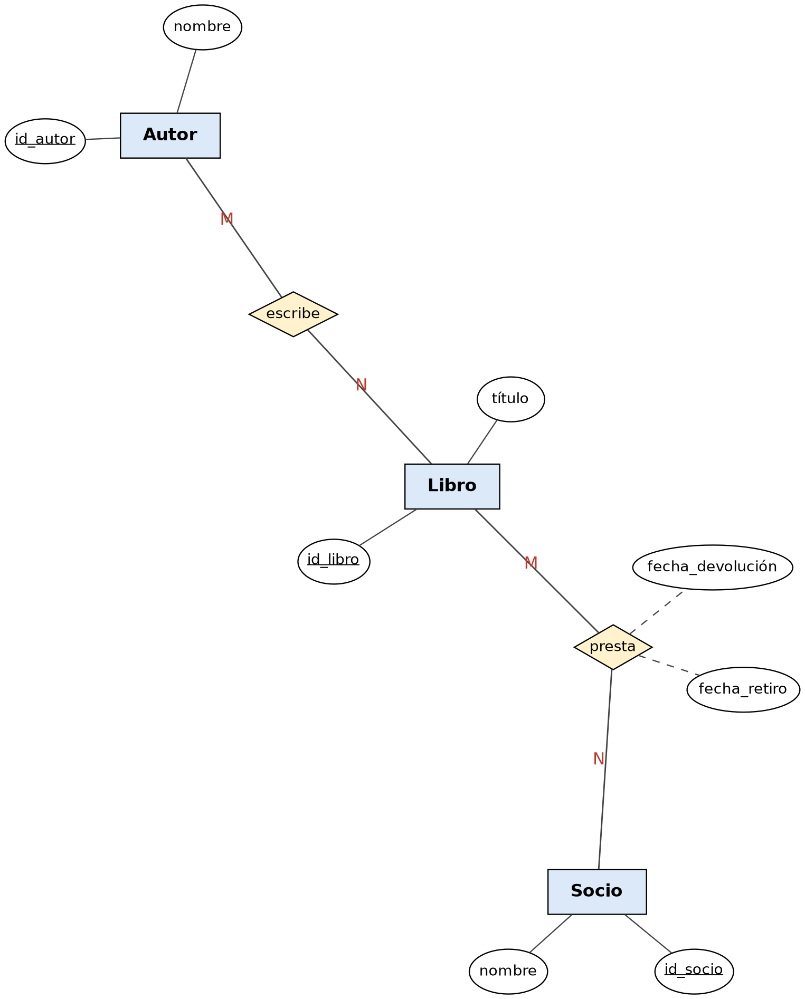

# Ejemplo 1: Sistema de Biblioteca

## Enunciado

Una biblioteca registra libros y autores. Un libro puede tener varios autores y un autor varios libros. Los socios toman libros prestados; de cada préstamo interesan la fecha de retiro y la de devolución.

## Diagrama Entidad-Relación



---
## Modelo Relacional 


---
## Codigo MySQL
```sql


Create Table Autor (
    id_autor Int Primary Key,
    nombre   Varchar(100) Not Null
);

Create Table Libro (
    id_libro Int Primary Key,
    titulo   Varchar(150) Not Null
);

Create Table Escrito (
    id_libro Int Not Null,
    id_autor Int Not Null,
    Primary Key (id_libro, id_autor),
    Foreign Key (id_libro) References Libro (id_libro),
    Foreign Key (id_autor) References Autor (id_autor)
);

Create Table Socio (
    id_socio Int Primary Key,
    nombre   Varchar(100) Not Null
);

Create Table Prestamo (
    id_libro         Int  Not Null,
    id_socio         Int  Not Null,
    fecha_retiro     Date Not Null,
    fecha_devolucion Date,
    Primary Key (id_libro, id_socio),
    Foreign Key (id_libro) References Libro (id_libro),
    Foreign Key (id_socio) References Socio (id_socio)
);

```
---

[Volver al índice de Modelos Entidad-Relación](README.md) · [Volver a Unidad 1](../README.md)
