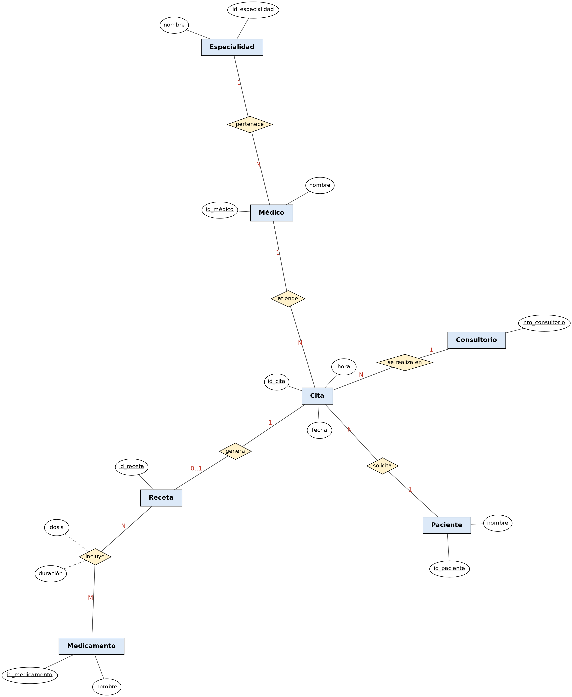

# Ejemplo 3: Clínica Médica

## Enunciado

Los pacientes solicitan citas; cada cita la atiende un médico a un paciente en fecha, hora y consultorio. De algunas citas se genera una receta que incluye medicamentos con dosis y duración. Cada médico pertenece a una especialidad.

## Diagrama Entidad-Relación

---

[Volver al índice de Modelos Entidad-Relación](README.md) · [Volver a Unidad 1](../README.md)
