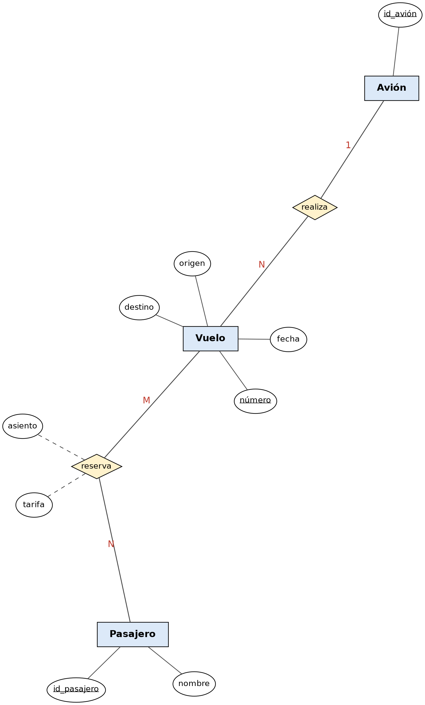

# Ejemplo 4: Sistema de Aerolínea

## Enunciado

Una aerolínea opera vuelos (cada uno con número, fecha, origen y destino), cada vuelo lo realiza un avión. Los pasajeros realizan reservas para un vuelo específico, indicando asiento y tarifa pagada en el momento de la reserva.

## Diagrama Entidad-Relación

---

[Volver al índice de Modelos Entidad-Relación](README.md) · [Volver a Unidad 1](../README.md)
