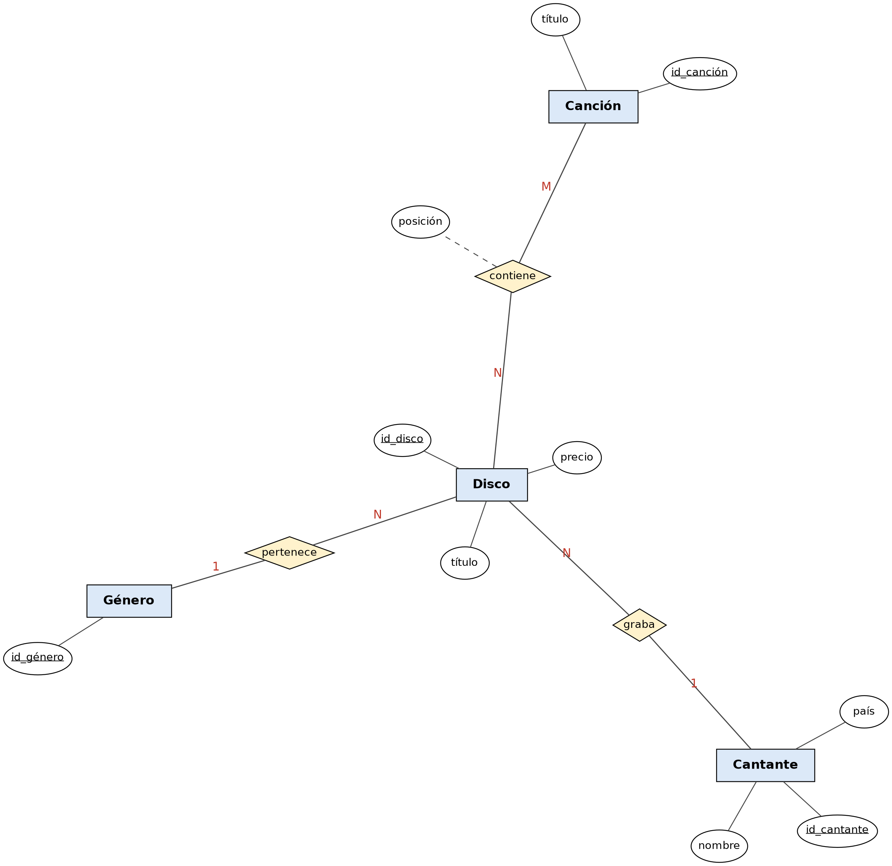

# Ejercicio 7: Discos Musicales

## Enunciado

La tienda vende discos de diferentes géneros musicales y cantantes.

- Cada género musical tiene un identificador.
- Cada disco tiene título, género musical, precio y cantante.
- De un cantante se registra el nombre y su país. Todo disco pertenece a un cantante y un cantante puede tener muchos discos. Además, un disco tiene un conjunto de canciones (identificador y título).
- Un disco tiene muchas canciones y una canción puede estar en varios discos. Interesa conocer la posición de una canción en un determinado disco.

## Diagrama Entidad-Relación



---
## Modelo Relacional 


---
## Codigo MySQL
```sql

Create Table Genero (
    id_genero Varchar(40) Primary Key
);
 
Create Table Cantante (
    id_cantante Int Primary Key,
    nombre      Varchar(100) Not Null,
    pais        Varchar(60)  Not Null
);
 
Create Table Disco (
    id_disco    Int Primary Key,
    titulo      Varchar(150) Not Null,
    precio      Decimal(8,2) Not Null,
    id_genero   Varchar(40)  Not Null,
    id_cantante Int Not Null,
    Foreign Key (id_genero)   References Genero (id_genero),
    Foreign Key (id_cantante) References Cantante (id_cantante)
);
 
Create Table Cancion (
    id_cancion Int Primary Key,
    titulo     Varchar(150) Not Null
);
 
Create Table Contiene (
    id_disco   Int Not Null,
    id_cancion Int Not Null,
    posicion   Int Not Null,
    Primary Key (id_disco, id_cancion),
    Foreign Key (id_disco)   References Disco (id_disco),
    Foreign Key (id_cancion) References Cancion (id_cancion)
);

```

---

[Volver al índice de Modelos Entidad-Relación](README.md) · [Volver a Unidad 1](../README.md)
