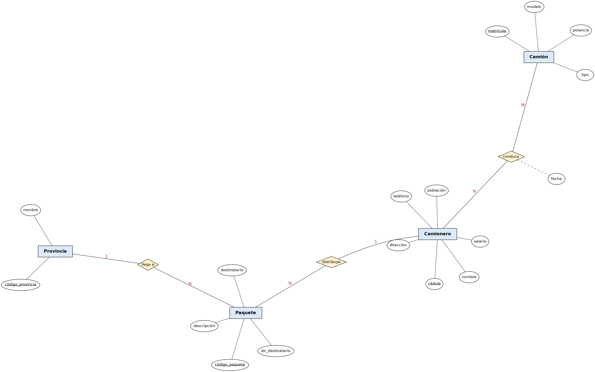

# Ejercicio 8: Camiones

## Enunciado

Se desea informatizar la gestión de una empresa de transporte que reparte paquetes por toda España. Los encargados de llevar los paquetes son los camioneros, de los que se quiere guardar la cédula, nombre, teléfono, dirección, salario y población en que vive. De los paquetes transportados interesa conocer el código del paquete, descripción, destinatario y dirección del destinatario.

Un camionero distribuye muchos paquetes, y un paquete sólo puede ser distribuido por un camionero. De las provincias a las que llegan los paquetes interesa guardar el código de provincia y el nombre. Un paquete sólo puede llegar a una provincia. Sin embargo, a una provincia pueden llegar varios paquetes.

De los camiones que llevan los camioneros, interesa conocer la matrícula, modelo, tipo y potencia. Un camionero puede conducir diferentes camiones en fechas diferentes, y un camión puede ser conducido por varios camioneros.

## Diagrama Entidad-Relación



---
## Modelo Relacional 


---
## Codigo MySQL
```sql

Create Table Provincia (
    codigo Varchar(5) Primary Key,
    nombre Varchar(60) Not Null
);
 
Create Table Camionero (
    cedula    Varchar(10) Primary Key,
    nombre    Varchar(100) Not Null,
    telefono  Varchar(15),
    direccion Varchar(150),
    salario   Decimal(8,2) Not Null,
    poblacion Varchar(60)
);
 
Create Table Paquete (
    codigo                 Varchar(15) Primary Key,
    descripcion            Varchar(200),
    destinatario           Varchar(100) Not Null,
    direccion_destinatario Varchar(150) Not Null,
    codigo_provincia       Varchar(5)   Not Null,
    cedula_camionero       Varchar(10)  Not Null,
    Foreign Key (codigo_provincia) References Provincia (codigo),
    Foreign Key (cedula_camionero) References Camionero (cedula)
);
 
Create Table Camion (
    matricula Varchar(10) Primary Key,
    modelo    Varchar(50),
    tipo      Varchar(40),
    potencia  Int
);
 
Create Table Conduce (
    cedula    Varchar(10) Not Null,
    matricula Varchar(10) Not Null,
    fecha     Date Not Null,
    Primary Key (cedula, matricula),
    Foreign Key (cedula)    References Camionero (cedula),
    Foreign Key (matricula) References Camion (matricula)
);
 


```

---

[Volver al índice de Modelos Entidad-Relación](README.md) · [Volver a Unidad 1](../README.md)
