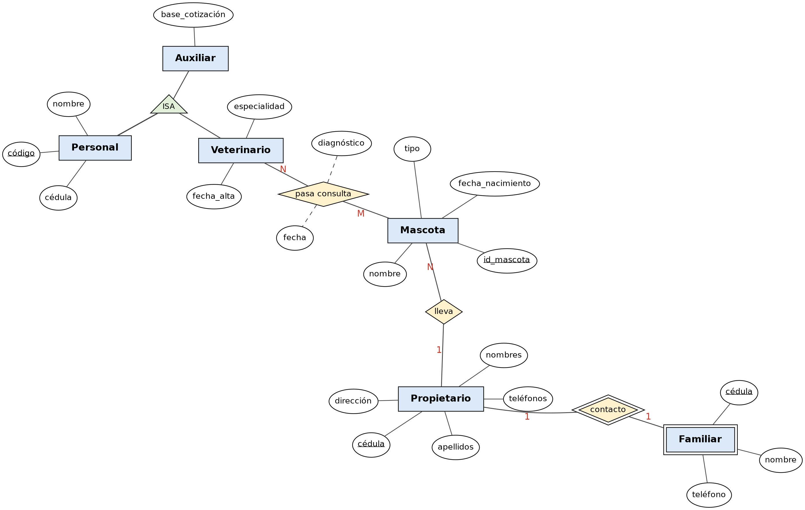

# Ejercicio 9: Veterinaria

## Enunciado

- Del propietario interesa: cédula, apellidos, nombres, dirección y teléfonos.
- De la mascota interesa: identificador, nombre, fecha de nacimiento y tipo.
- Un propietario puede llevar una o varias mascotas. Una mascota la lleva uno y solo un propietario.
- Del personal de la clínica veterinaria interesa un código, la cédula y el nombre.
- Entre el personal de la clínica se distingue a los veterinarios y los auxiliares, pudiendo haber otros tipos.
  - Del veterinario se guarda además su fecha_alta y especialidad.
  - De los auxiliares interesa su base de cotización.
- Las mascotas pasan consulta con los veterinarios:
  - Un veterinario puede pasar consulta a ninguna o a varias mascotas.
  - Una misma mascota ha pasado consulta una o más veces en fechas diferentes con varios veterinarios.
  - Al pasar consulta se realiza un diagnóstico.
- Cada propietario tiene un familiar de contacto para casos de emergencia. De este familiar interesa la cédula, nombre y teléfono. Si el propietario se da de alta en la clínica veterinaria, el familiar ya no interesa. El familiar es contacto de un solo propietario.

## Diagrama Entidad-Relación



---
## Modelo Relacional 


---
## Codigo MySQL
```sql


Create Table Propietario (
    cedula    Varchar(10) Primary Key,
    apellidos Varchar(80) Not Null,
    nombres   Varchar(80) Not Null,
    direccion Varchar(150)
);
 
Create Table Telefono_propietario (
    cedula   Varchar(10) Not Null,
    telefono Varchar(15) Not Null,
    Primary Key (cedula, telefono),
    Foreign Key (cedula) References Propietario (cedula)
);
 
Create Table Familiar_contacto (
    cedula_propietario Varchar(10) Not Null,
    cedula             Varchar(10) Not Null,
    nombre             Varchar(100) Not Null,
    telefono           Varchar(15),
    Primary Key (cedula_propietario, cedula),
    Foreign Key (cedula_propietario) References Propietario (cedula)
);
 
Create Table Mascota (
    id_mascota         Int Primary Key,
    nombre             Varchar(60) Not Null,
    fecha_nacimiento   Date,
    tipo               Varchar(40) Not Null,
    cedula_propietario Varchar(10) Not Null,
    Foreign Key (cedula_propietario) References Propietario (cedula)
);
 
Create Table Personal (
    codigo Int Primary Key,
    cedula Varchar(10) Not Null Unique,
    nombre Varchar(100) Not Null
);
 
Create Table Veterinario (
    codigo       Int Primary Key,
    fecha_alta   Date Not Null,
    especialidad Varchar(80),
    Foreign Key (codigo) References Personal (codigo)
);
 
Create Table Auxiliar (
    codigo          Int Primary Key,
    base_cotizacion Decimal(8,2) Not Null,
    Foreign Key (codigo) References Personal (codigo)
);
 
Create Table Consulta (
    id_mascota         Int Not Null,
    codigo_veterinario Int Not Null,
    fecha              Date Not Null,
    diagnostico        Varchar(255),
    Primary Key (id_mascota, codigo_veterinario),
    Foreign Key (id_mascota)         References Mascota (id_mascota),
    Foreign Key (codigo_veterinario) References Veterinario (codigo)
);
 


```

---

[Volver al índice de Modelos Entidad-Relación](README.md) · [Volver a Unidad 1](../README.md)
